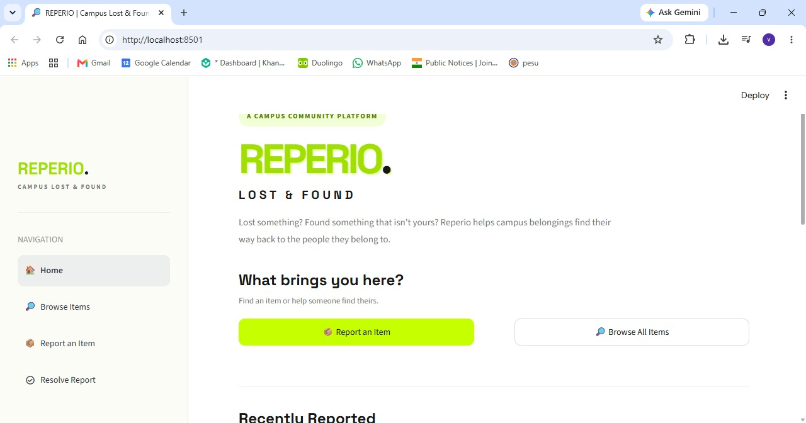

# REPERIO – Campus Lost and Found

REPERIO is a web-based campus Lost and Found management system built to help students report, browse, and resolve lost or found items within their campus.

## Features

- **Report an Item:** Submit details of lost or found items.
- **Browse Reports:** View active reports and search or filter listings.
- **Resolve a Report:** Use a unique report code to mark a report as resolved.
- **Database Storage:** Store report information using SQLite.

## Tech Stack

- Python
- Streamlit
- SQLite

## Project Structure

```text
Campus_lost_found/
│
├── app.py
├── database.py
├── requirements.txt
├── .gitignore
└── Pages/
    ├── 1_report_an_item.py
    ├── 2_browse.py
    └── 3_resolve_report.py
```

## Run Locally

1. Clone the repository:

   ```bash
   git clone https://github.com/talandagevarshithaschool-eng/REPERIO.git
   ```

2. Navigate to the project directory:

   ```bash
   cd REPERIO
   ```

3. Install the dependencies:

   ```bash
   pip install -r requirements.txt
   ```

4. Start the application:

   ```bash
   streamlit run app.py
   ```

## Data and Privacy

The application uses a local SQLite database. The database file is excluded from version control so that local report data and contact information are not published in the repository.

## Project Status

Working prototype. Developed as a campus-focused Lost and Found management solution.

## Application Screenshots

### Home Page


### Report an Item


### Browse Reports


### Resolve Reports
